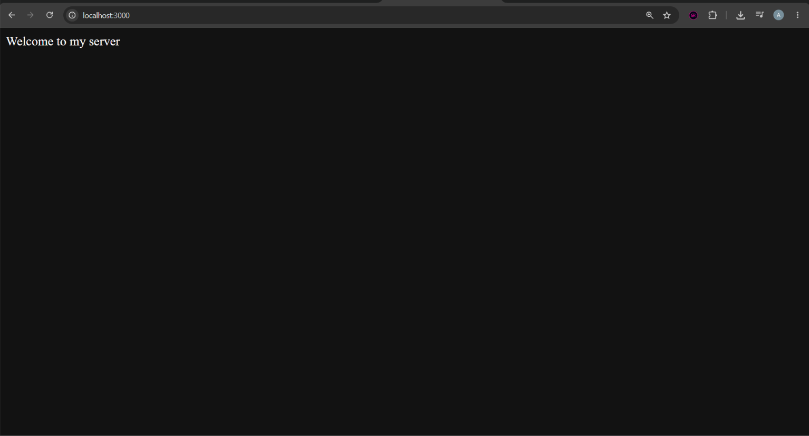
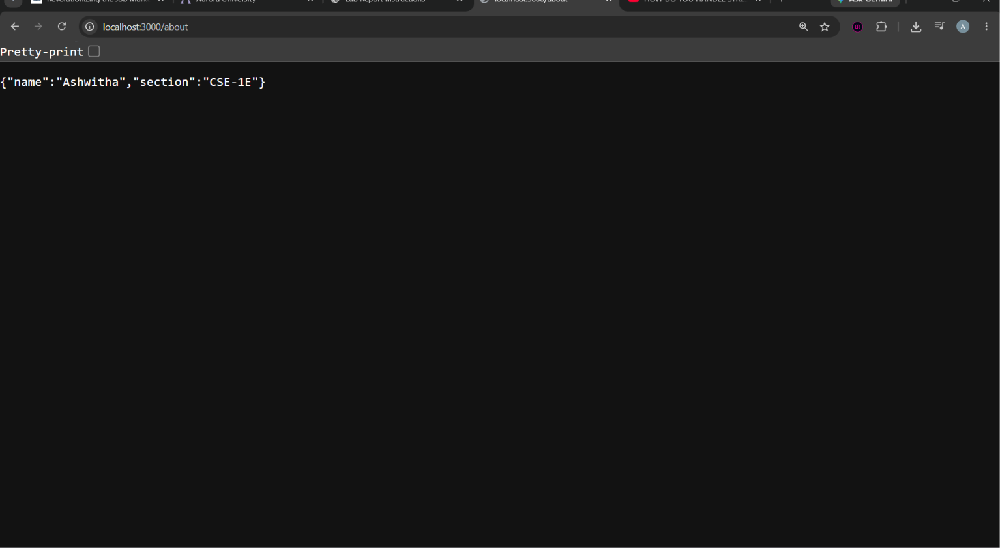
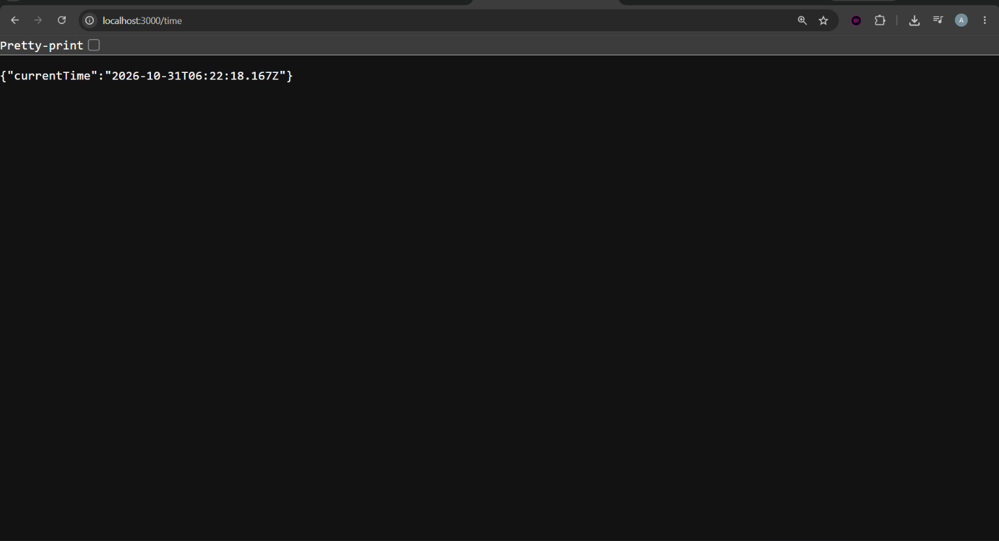
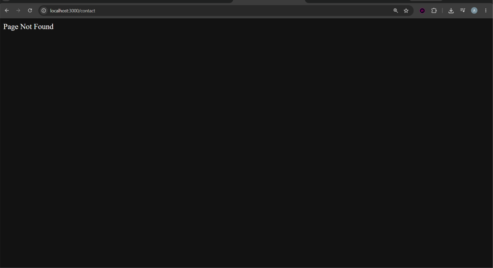

# Lab 1: Node.js and Express server

## Student Details

- Name: Ashwitha Samala
- Registration Number: 252U1R1223
- Section:CSE-2E
- Subject: Backend Development Fundamentals

## Live Link

Deployed URL: https://ashwitha-lab01.onrender.com

## Objective

To set up a Node.js project and build a web server using the built-in HTTP module and Express.js.

## Technologies Used

- Node.js
- Express.js
- JavaScript
- npm

## Installation and Execution

1. Clone or download the repository.
2. Navigate to the lab-01 folder.
3. Install dependencies:

```bash
npm install
```

4. Start the Express server:

```bash
node app.js
```

5. Open `http://localhost:3000` in your browser.

### Plain Node.js HTTP Server

To run the basic HTTP server separately:

```bash
node http-server.js
```

## Package.json Fields

| Field | Description |
|---|---|
| name | Project name |
| version | Project version |
| description | Project description |
| main | Main entry file |
| scripts | Project execution commands |
| keywords | Related search keywords |
| author | Developer name |
| license | Project licence |
| type | JavaScript module system |
| dependencies | Installed project packages |

## API Endpoints

| Method | Endpoint | Description |
|---|---|---|
| GET | `/` | Displays welcome message |
| GET | `/about` | Returns name and section in JSON |
| GET | `/time` | Returns current date and time |
| GET | Unknown path | Returns 404 Page Not Found |

## Screenshots

### Home Route


### About Route


### Time Route


### 404 Route


## Environment Variables

No environment variables are required for this lab.

## Problems Faced and Solutions

1. Initially, the server could not find `http-server.js` because the terminal was in the parent directory. This was solved by navigating into the lab-01 folder.
2. Port 3000 was already in use because the plain HTTP server was still running. This was solved by stopping the previous server before starting Express.

## Conclusion

Successfully created a Node.js HTTP server and an Express server with three GET routes and a 404 handler. Tested the endpoints and verified their HTTP status codes.