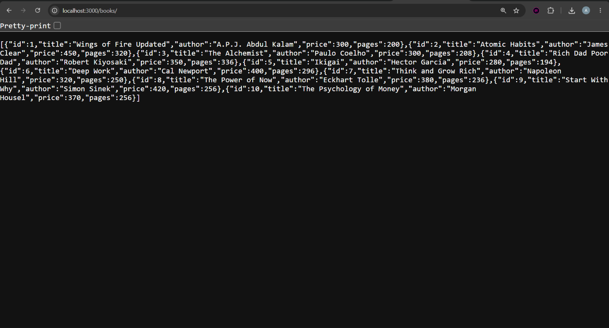
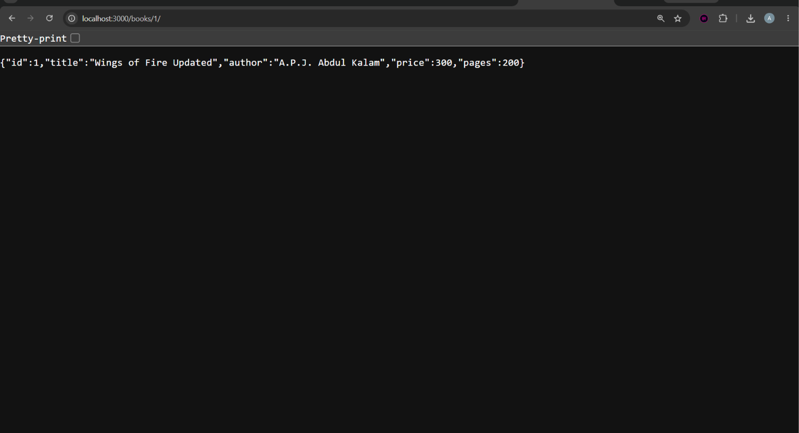
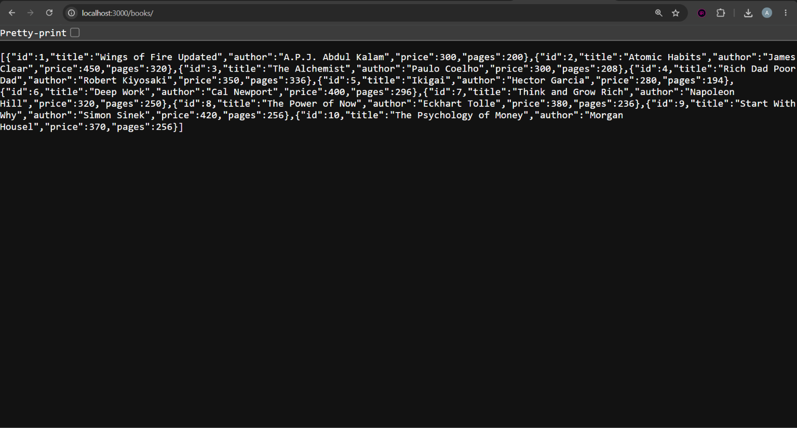
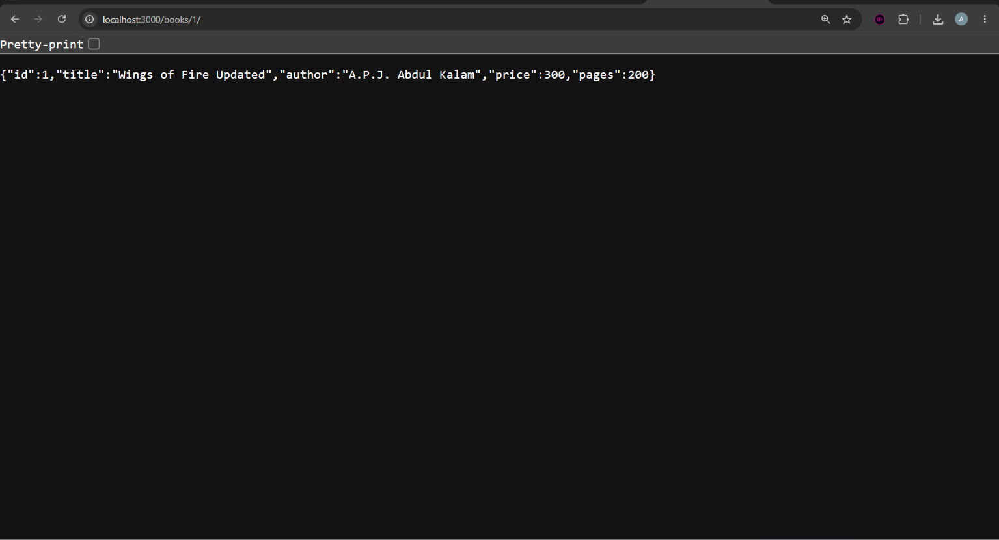
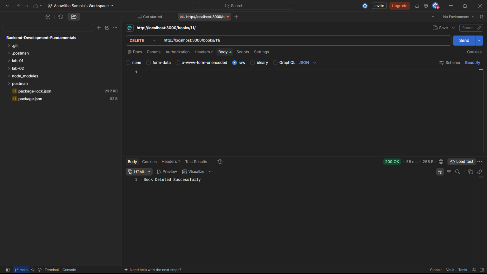

# Lab 02 – SQLite Database and CRUD Routes

## Student Details

- Name: Ashwitha Samala
- Registration Number: 252U1R1223
- Section: CSE-2E
- Subject: Backend Development Fundamentals

## Project Description

This project demonstrates how to connect a Node.js Express server with an SQLite database and perform CRUD (Create, Read, Update, Delete) operations through REST APIs.

The database stores book details such as ID, title, author, price, and number of pages.

## Technologies Used

- Node.js
- Express.js
- SQLite
- SQLite3
- JavaScript
- Postman
- Nodemon

## Database Structure

Database: `books.db`

Table: `book`

| Column | Data Type |
|---|---|
| id | INTEGER PRIMARY KEY |
| title | TEXT |
| author | TEXT |
| price | INTEGER |
| pages | INTEGER |

The database contains 10 initial book records.

## Installation and Execution

### 1. Install dependencies

```bash
npm install
```

### 2. Start the server

```bash
npx nodemon app.js
```

### 3. Server URL

```text
http://localhost:3000/
```

## API Endpoints

| Method | Endpoint | Description |
|---|---|---|
| GET | `/books/` | Get all books |
| GET | `/books/:bookId/` | Get a specific book |
| POST | `/books/` | Add a new book |
| PUT | `/books/:bookId/` | Update book details |
| DELETE | `/books/:bookId/` | Delete a book |

## API Testing

All five API endpoints were tested using Postman.

The database operations were also verified using the SQLite command-line interface.

## Screenshots

### GET All Books


### GET Book by ID


### POST Book


### PUT Book


### DELETE Book


## Notes

- Used parameterized SQL queries with `?` placeholders.
- Used async/await for database operations.
- Used Nodemon to automatically restart the server when code changes.
- Verified database changes after POST, PUT, and DELETE operations.

## Live Deployment

Not deployed yet. Local testing was completed successfully.

